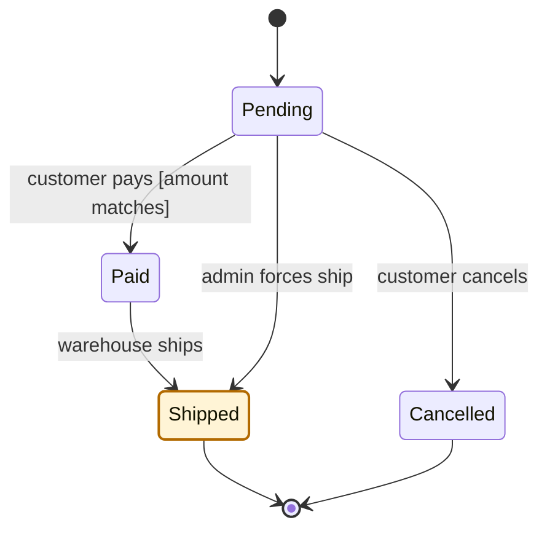

Chart the system in `$ARGUMENTS`. If none is given, take the flow this session is working on. If there is none, ask for one. Ask nothing else; pick sensible defaults.

The chart is for a reader who decides whether the behavior is right. The model does not decide that. This skill charts and checks; it does not fix. Report what breaks and offer the fix. Change code only when the user asks.

## 1. Find the machine in the code

The source of truth is the code, not the docs and not the names.

- Find the state: the enum, status column, `type` tag, reducer, or set of flags that says where the system is. Several flags that together decide behavior are one state; chart their combinations that can actually occur.
- Find **every write** to that state: grep for assignments, setters, `UPDATE ... SET status`, reducer cases, event handlers. Each write is a transition.
- Look outside the happy path too: retries, timeouts, cron jobs, webhooks, admin endpoints, migrations, seed scripts, error handlers. Bugs live in the writes nobody drew.
- If the search spans more than five files, hand it to a read-only `Explore` subagent and ask only for the transition table below.
- If there is no code yet (a design), chart the description and say so in the hand-off.

Build one transition table. Keep it; the chart and every finding cite it.

| From      | Event           | Guard             | To     | Where                  |
| --------- | --------------- | ----------------- | ------ | ---------------------- |
| `pending` | payment webhook | `amount == total` | `paid` | `orders/webhook.ts:42` |

Also list the start states and the states that are meant to be final.

## 2. Write down the rules

A rule is a plain sentence the reader agrees must always hold: _"An order is never shipped before it is paid."_ _"A refunded order never goes back to paid."_ _"Every job ends in done or failed."_

- Take rules from the user, then from the code (asserts, validations, DB constraints), tests, and docs.
- If the user gave none, propose one to three and state them. Do not stall on this.
- Never weaken a rule to make it pass. A rule that fails is the finding.

## 3. Check the table

Walk the table by hand. For each item, cite the rows from step 1.

- **Unreachable** — a state no path from a start state reaches. Dead code, or a missing transition.
- **Dead end** — a state that is not final and has no way out. The system gets stuck there.
- **Unhandled event** — an event that can arrive in a state with no row for it: cancel during processing, a duplicate webhook, a timeout, a retry after success, a crash between two writes. Say what the code does then: ignores it, throws, or overwrites the state.
- **Bypass** — a write that sets the state directly and skips the guard every other path goes through.
- **Rule break** — for each rule that can fail, the **shortest path** from a start state to the breaking state, one step per line, each step with its `file:line`.

This is a careful reading, not an exhaustive search. If the bug depends on many concurrent actors interleaving, say the hand check cannot cover it and suggest a model checker (TLA+ / TLC) as the next step.

## 4. Draw the chart

Mermaid `stateDiagram-v2`:

- **State labels** say what the reader sees or cares about ("Waiting for payment"), not variable names.
- **Arrow labels** say what happens, in the reader's words ("customer pays"), not function names. Put the guard in brackets at the end. If a hidden value picks the destination, name the outcome in the label.
- Use `[*]` for start and for the final states.
- Use nested states (`state Checkout { ... }`) for phases. Use parallel regions (`--`) only for parts that really change independently.
- **Marks**: `breaks` on a state where a rule always fails, `mayBreak` where it fails on some paths in, `stuck` on dead ends and unreachable states. Add a `note right of <State>` naming the rule it breaks.

Keep it readable: aim for **about 20 arrows or fewer**.

- First merge states that behave the same and drop detail the reader does not need.
- Never merge two states that break different rules. Never merge in a way that turns a `breaks` state into `mayBreak`.
- If it is still busy, leave out repeating arrows (for example "cancel" from every state) and say in a note which ones are left out. Every state must stay reachable from a start, and every state with a way out must keep at least one arrow out.
- If one chart cannot stay readable, draw one chart per phase.

## 5. Prove each break

A break found by reading is a claim. Replay each rule-break path against the real code, one step per event: a test that walks the path, or a live repro. Report each break as **proven** (quote the decisive output line) or **not proven**. If the path does not reproduce, assume the reading was wrong until shown otherwise. This is the `prove-it` discipline; skip it only when the user asks for the chart alone.

## 6. Deliver

- Write the transition table, rules, chart, and findings to `.scratch/<slug>/statechart.md`, so the next session can build on it.
- If an Artifact tool is available, also publish the chart as a page and follow that tool's own rules. Give the user the link.

Reply with:

1. The chart as a `mermaid` code block (GitHub and GitLab render it).
2. One line per finding: the kind, the rule or state, the path or `file:line`, proven or not.
3. What the chart leaves out: arrows hidden, states merged, writes not traced.

Do not repeat the transition table in chat; point to the file.
